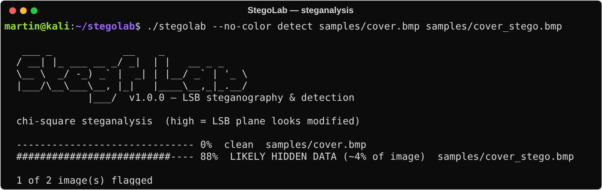
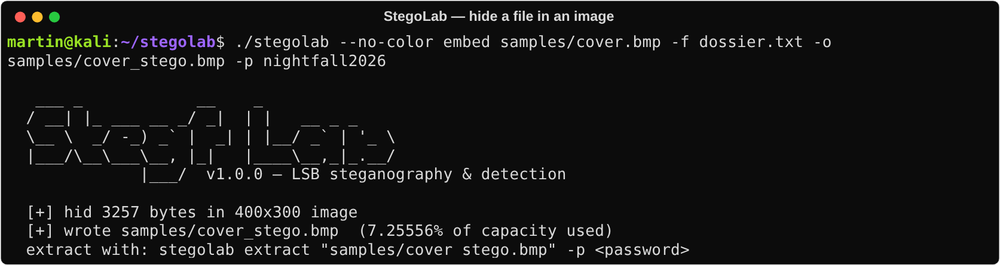
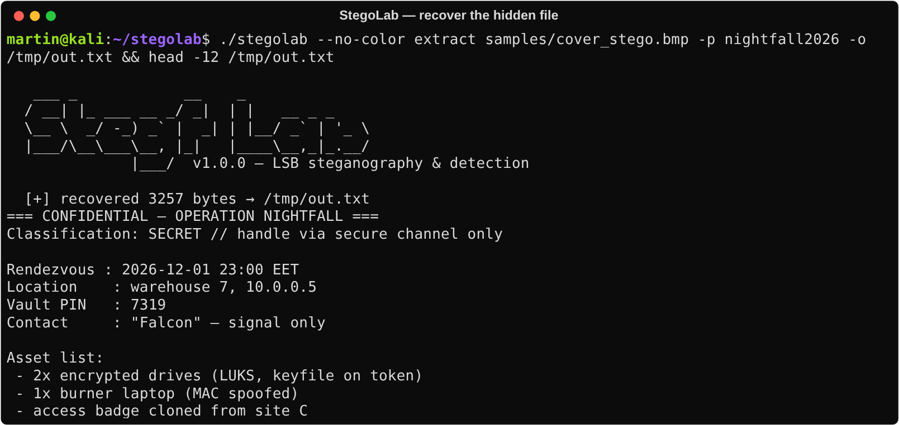
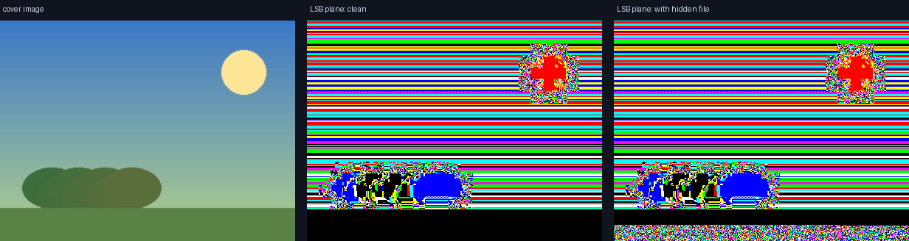

<div align="center">

# 🖼️ StegoLab

**Hide secret messages inside images, then catch them with statistical steganalysis. C++17, from scratch.**




</div>
> 🎥 **[Watch the demo video →](docs/demo.mp4)** (download to play)


---

## 📖 About

Steganography hides the *existence* of a message (unlike cryptography, which hides its *content*).
StegoLab does both sides of the game:

- **🔵 Blue/Red:** hide a message or file inside a BMP image using **LSB (Least Significant Bit)** encoding, protected by a password
- **🔎 Forensics:** **detect** hidden data in an image with a **chi-square attack**, and estimate how much is embedded, without needing the password

Everything is written from scratch in C++17: the BMP reader/writer, the LSB codec, the password
keystream (built on a from-scratch SHA-256), and the chi-square steganalysis with its own incomplete-gamma function. No libraries.

## ✨ Features

| Command | What it does |
|---|---|
| `embed`   | Hide text or any file in a cover image, whitened with a **password-derived SHA-256 keystream** |
| `extract` | Recover the message — only the correct password works; a wrong one fails cleanly |
| `detect`  | **Chi-square steganalysis**: flag images that carry hidden data and estimate the embedded fraction |
| `reveal`  | Render the **LSB bit-plane** as an image so you can *see* the hidden data |
| `info`    | Capacity (how much you can hide) and a quick detection score |

## 📸 Screenshots

**The whole workflow — hide, detect, recover:**

<table>
<tr><td width="50%"><b>Hide a confidential file</b><br></td>
<td width="50%"><b>Recover it with the password</b><br></td></tr>
</table>

**See the hidden data with the LSB bit-plane.** The clean image's bit-plane is structured; the one with
a hidden file shows a band of random noise where the data lives:



---

## 🚀 Tutorial

### 1. Build

```bash
git clone https://github.com/Martun1/stegolab.git
cd stegolab
cmake -S . -B build -DCMAKE_BUILD_TYPE=Release
cmake --build build
ctest --test-dir build        # BMP round-trip, embed/extract, detection
```

On **Windows**, open the folder in CLion or Visual Studio, or run the same CMake commands.

### 2. Check what a cover image can hold

```bash
./build/stegolab info samples/cover.bmp
```

An image can hide about `width × height × 3 / 8` bytes (one bit per color channel).

### 3. Hide a secret

```bash
# hide text
./build/stegolab embed samples/cover.bmp -m "Vault PIN: 7319" -o secret.bmp -p "my-password"

# hide a whole file
./build/stegolab embed samples/cover.bmp -f plans.pdf -o secret.bmp -p "my-password"
```

`secret.bmp` looks identical to the human eye, but only the lowest bit of each color has changed.

### 4. Recover it

```bash
./build/stegolab extract secret.bmp -p "my-password"
# wrong password? you get an error, not the message:
./build/stegolab extract secret.bmp -p "guess"   # -> no hidden message found
```

### 5. Play detective

```bash
./build/stegolab detect samples/cover.bmp secret.bmp
```

The clean image scores near 0%. The one with hidden data is flagged, with an estimate of how much of
the image carries a payload. Then *see* it:

```bash
./build/stegolab reveal secret.bmp -o plane.bmp   # open plane.bmp
```

---

## 🧠 How it works

**Hiding (LSB):** each pixel has Blue, Green, Red bytes. Changing the lowest bit of a byte shifts the
color by 1/255 — invisible. StegoLab writes the message bits into these LSBs:

```
pixel byte 10110100  →  10110101   (stored a '1')
```

Before writing, the message (plus a `STG1` magic + length header) is XORed with a keystream from
`SHA-256(password ‖ counter)`. So the bits look random, and the wrong password can't read them.

**Detecting (chi-square):** in a natural photo the two values of each pair `(2k, 2k+1)` appear with
*different* frequencies. LSB embedding flips lowest bits roughly 50/50, which pushes each pair toward
*equal* counts. The chi-square test measures that balance; StegoLab scans growing prefixes of the image
(sequential embedding fills from the start) and reports the most suspicious region.

> ⚠️ The chi-square attack works best on photographic images and on large payloads. Small messages, or
> synthetic/very smooth images, are harder, which is exactly why real steganalysis combines several methods.

## 🧱 Project structure

```
stegolab/
├── src/bmp.hpp       # 24-bit BMP reader/writer
├── src/stego.hpp     # LSB embed/extract, password keystream, chi-square steganalysis
├── src/sha256.hpp    # SHA-256 from scratch (shared with my hashguard project)
├── src/main.cpp      # CLI: embed / extract / detect / reveal / info
├── tests/test_stego.cpp
├── samples/cover.bmp # a photographic cover image
└── .github/workflows/ci.yml   # build + test on Linux/Windows/macOS
```

## 🗺️ Roadmap

- [ ] PNG support (lossless, more realistic than BMP)
- [ ] RS analysis and Sample Pair Analysis for stronger detection
- [ ] Spread-spectrum embedding (harder to detect)
- [ ] Capacity-aware compression of the payload before embedding

## ⚖️ Note

For learning about steganography and digital forensics. Hide only content you're allowed to, and analyse only images you own or are authorized to inspect.

---

<div align="center">
Made by <a href="https://github.com/Martun1">Martin Ivanov</a> · eJPT · CCNA · Computer Science @ NBU
</div>
